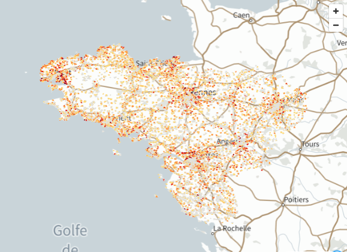

# Où ouvrir un fast-food en Pays de la Loire et en Bretagne ?

Un outil cartographique d'aide à la décision. Il classe toutes les zones constructibles des deux régions selon leur potentiel pour ouvrir un restaurant rapide.

**[Ouvrir la carte](https://ezechiel18.github.io/devplus/etude-fastfood/)**



## L'étude en trois chiffres

| 242 514                            | 39 943                                                                      | 399                                   |
|:----------------------------------:|:---------------------------------------------------------------------------:|:-------------------------------------:|
| zones de 500 m sur 500 m analysées | retenues : constructibles, hors site naturel protégé et hors zone inondable | prioritaires : le 1 % le mieux classé |

## Ce que permet l'outil

- **Voir le classement de l'étude** sur une carte, en cinq classes, de « Prioritaire » à « Peu favorable ».
- **Simuler ses propres priorités** : on règle l'importance de chaque critère de 0 à 100, et la carte se recalcule.
- **Filtrer** par département et par niveau de chaque critère, ou chercher une commune ou une adresse.
- **Lire la fiche d'une zone** : sa classe, son rang et la valeur réelle des quatre critères, puis la télécharger en PDF.
- **Trouver de meilleures alternatives** à moins de 5 km, qui font mieux sur un critère sans perdre sur les autres.
- **Télécharger sa sélection** en tableau Excel ou en GeoJSON, avec une notice : sources, date et réglages utilisés.

L'outil aide à repérer des zones à étudier. Il ne remplace ni une visite sur place, ni l'étude du local commercial.

---

## Méthode

### Démarche

Une démarche en entonnoir, sur une grille de carrés de 500 m en Lambert-93 (EPSG:2154) :

1. **Éligibilité** : on garde les carrés qui touchent une zone U ou AU du plan local d'urbanisme, hors Natura 2000 (ZPS, ZSC/SIC) et hors zone inondable par débordement de cours d'eau (crue centennale).
2. **Quatre critères**, calculés pour chaque carré retenu, puis ramenés entre 0 et 1 (normalisation min-max).
3. **Score** : somme pondérée des quatre critères, puis rang et classe.

### Critères et poids

| Critère         | Mesure                                                                                                                               | Traitement                                                 | Poids |
| --------------- | ------------------------------------------------------------------------------------------------------------------------------------ | ---------------------------------------------------------- |:-----:|
| Accès routier   | distance du centre du carré à la route numérotée ou nommée la plus proche (BD TOPO)                                                  | `1 - min(distance, 3000) / 3000`                           | 35 %  |
| Pouvoir d'achat | niveau de vie moyen des habitants (Filosofi 2021, carreaux de 200 m)                                                                 | min-max ; médiane de l'étude pour les carrés sans habitant | 30 %  |
| Population      | habitants au km²                                                                                                                     | `ln(1 + densité)`, puis min-max                            | 20 %  |
| Concurrence     | indice de Huff : somme des `poids / distance²` des fast-foods à moins de 2 km (plancher de 250 m, poids selon la tranche d'effectif) | `ln(1 + Huff)`, puis min-max, inversé                      | 15 %  |

```
Score = 0,35 Accès + 0,30 Pouvoir d'achat + 0,20 Population + 0,15 (1 - Concurrence)
```

### Classes

| Classe         | Rangs           | Part       |
| -------------- | --------------- | ---------- |
| Prioritaire    | 1 à 399         | 1 %        |
| Très favorable | 400 à 1 997     | 1 à 5 %    |
| Favorable      | 1 998 à 7 989   | 5 à 20 %   |
| Moyen          | 7 990 à 19 972  | 20 à 50 %  |
| Peu favorable  | 19 973 à 39 943 | 50 à 100 % |

### Sources

| Donnée                              | Source                                                |
| ----------------------------------- | ----------------------------------------------------- |
| Limites des régions, réseau routier | IGN Géoplateforme (ADMIN EXPRESS, BD TOPO)            |
| Plans locaux d'urbanisme            | Géoportail de l'urbanisme                             |
| Natura 2000                         | INPN                                                  |
| Zones inondables                    | Géorisques (Directive inondation)                     |
| Fast-foods (NAF 56.10C)             | API Recherche d'entreprises (base SIRENE)             |
| Population et niveau de vie         | Insee, Filosofi 2021, carreaux de 200 m               |
| Fonds de carte, géocodage           | IGN Géoplateforme (Plan IGN, photographies aériennes) |

Données publiques, traitées en novembre 2026.

### Limites

- La submersion marine n'a pas pu être prise en compte (délai du serveur Géorisques dépassé).
- Les communes sans plan local d'urbanisme ne sont pas retenues.
- Seuls les fast-foods déclarés en 56.10C sont comptés ; l'effectif, souvent inconnu, reçoit un poids par défaut.
- Les poids des critères sont une hypothèse métier : le mode simulation permet de les faire varier.

---

## Partie technique

### Outils

- **FME 2024** : tout le traitement, des flux publics jusqu'à la couche finale `grille_score.gpkg`.
- **Python** (geopandas) : préparation de la couche pour le web (`scripts/preparer_donnees.py`).
- **MapLibre GL JS** : la carte. **SheetJS** : l'export Excel.
- Page statique (HTML, CSS, JavaScript), hébergée sur GitHub Pages.

### Contenu du dossier

| Fichier                       | Rôle                                                                        |
| ----------------------------- | --------------------------------------------------------------------------- |
| `index.html`                  | la page                                                                     |
| `css/style.css`               | la mise en forme                                                            |
| `js/app.js`                   | la carte, les deux modes, la fiche, les alternatives et les téléchargements |
| `data/zones.js`               | les données lues par la page (permet aussi de l'ouvrir par double-clic)     |
| `data/zones.geojson`          | les mêmes données en GeoJSON (WGS84), pour QGIS                             |
| `scripts/preparer_donnees.py` | le script qui produit les deux fichiers de données                          |
| `img/`                        | les images du README                                                        |

### Régénérer les données

Depuis une nouvelle sortie FME (`grille_score.gpkg`) et la couche des communes (`france_metro_com.gpkg`) :

```
pip install geopandas pyogrio
python scripts/preparer_donnees.py <dossier des données> data/zones.geojson
```

Le script rattache chaque carré à sa commune, retire les colonnes techniques de FME, passe en WGS84 et écrit `zones.geojson` et `zones.js`.

### Ouvrir en local

Un double-clic sur `index.html` suffit. Une connexion internet est nécessaire pour le fond de carte, la bibliothèque de carte et les polices.

---

Réalisé par **Ezéchiel Ametovena**. [LinkedIn](https://www.linkedin.com/in/ez%C3%A9chiel-ametovena-5a48a1196/)
